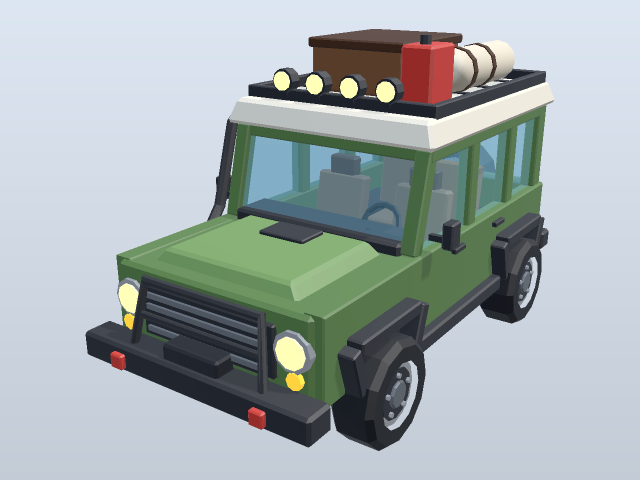
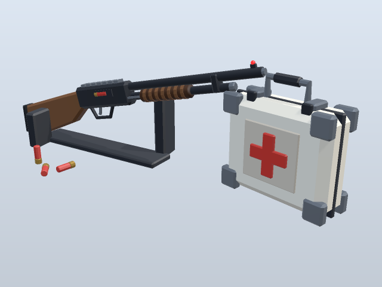
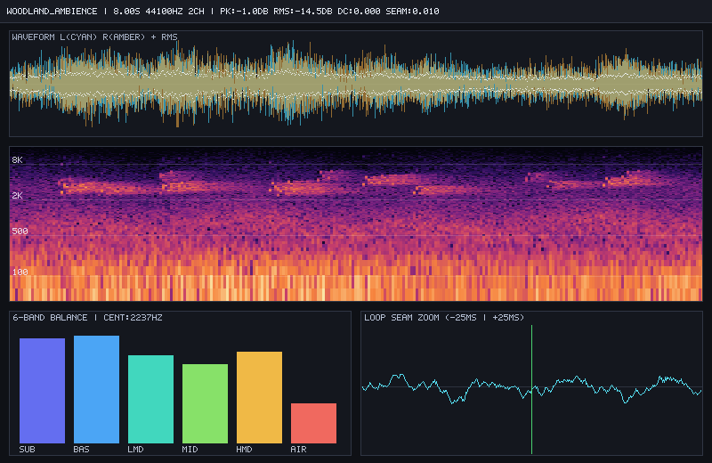

# Dullahan Artisan (`artisan`)

> **A headless, single-binary (~800 KB) Rust compiler built specifically for LLMs to author game-ready low-poly 3D PBR assets, shared color-palette atlases, and procedural SFX/music — no Blender, no DAW, no bloated MCP.**

Dullahan Artisan replaces fragile GUI/MCP round-trips and verbose JSON with a **token-dense, line-oriented plaintext DSL** (`.pal`, `.mdl`, `.sfx`, `.kit`), compiling directly to validated **`.glb`/`.gltf`** models (1 opaque draw call + optional translucent pass), **3-map PBR atlases** (`BaseColor`, `ORM`, `Emissive`), and **16-bit PCM `.wav`** audio — complete with a built-in multi-threaded PBR software orbit renderer and 5-panel spectrogram diagnostic plotter so any coding agent can visually inspect and iterate in a tight closed loop.

---

## Showcase (100% Generated from Plaintext DSL — Zero Blender / Zero DAW)

### 3D Game Assets (`.mdl` → `.glb` / `.gltf`)
All three packs below share a single **2.9 KB** 3-map PBR palette atlas ([`examples/palette.pal`](examples/palette.pal)) and pass strict glTF 2.0 binary & outward-normal validation:

| Off-Road 4×4 Vehicle (2 draws, translucent interior) | Modular Dungeon Kit (6 snap tiles, 1 draw call) | Weapon & Pickup Props (1 draw call) |
| :---: | :---: | :---: |
|  |  |  |
| [`offroad_4x4.mdl`](examples/models/offroad_4x4.mdl) | [`modular_dungeon_kit.mdl`](examples/models/modular_dungeon_kit.mdl) | [`props_shotgun_medkit.mdl`](examples/models/props_shotgun_medkit.mdl) |

### Procedural Audio, Seamless Loops & Music (`.sfx` / `.kit` → `.wav`)
Pure-DSP synthesis (PolyBLEP oscillators, stereo supersaws, FM, modal partials, Karplus-Strong plucks, 4 noise colors, Cytomic TPT SVF filters, Freeverb, tempo-synced ping-pong delay, 2-cycle pre-warm seamless looping, `--var N` variations) with visual spectrogram & loop-seam verification:

| Living Stereo Woodland Ambience (8s seamless loop, `seam=0.010`) | 4-Bar Multi-Track Musical Loop (116 BPM, `seam=0.005`) |
| :---: | :---: |
|  |  |
| [`woodland_ambience.sfx`](examples/audio/woodland_ambience.sfx) | [`arcade_anthem_loop.sfx`](examples/audio/arcade_anthem_loop.sfx) |

Also included: [`footstep_gravel.sfx`](examples/audio/footstep_gravel.sfx) (`--var 4` foley variations) and [`boss_impact_sfx.sfx`](examples/audio/boss_impact_sfx.sfx) (layered modal/sub impact) using shared voice library [`kit.kit`](examples/audio/kit.kit).

---

## Why Dullahan Artisan?

- **Headless & Instant**: Single **~800 KB** static binary compiled from zero-dependency Rust (`std` only) — builds and runs natively on **Linux, macOS, and Windows** with millisecond startup.
- **Built for LLMs**: Line-oriented syntax with short opcodes, `$var` math expressions, semantic material/voice names, `@id` part tags (`--focus <id>` zoom inspection), and `def`/`use`/`m=`/`rep=`/`rad=` composition — ~65–75% fewer tokens than JSON and trivial to diff/patch.
- **Game-Engine Friendly**: Every opaque 3D model batches matte, metallic, and emissive surfaces into **1 single PBR draw call** using standard glTF 2.0 / Godot 4 / UE5 / Unity `BaseColor` + `ORM` + `Emissive` atlases (embed by default or share externally via `--ext-pal`).
- **Closed-Loop QA Built In**:
  - **3D**: Multi-threaded 2×2 SSAA PBR software renderer with backface culling, PCF shadows, 2×2 turnarounds with grid/axis HUD, `--focus <id>` close-ups, and strict GLB/glTF validator (including per-triangle outward normal checks).
  - **Audio**: Quantitative CLI telemetry (`peak`, `RMS`, `DC`, `clip`, `seam Δ`, 6-band balance) + 5-panel Magma spectrogram & ±25 ms loop-seam zoom PNG.

### A Taste of the DSL

```text
# Shared PBR atlas (.pal) — one line per tile -> BaseColor + ORM + Emissive maps
grid 8x8@16 bg=#d4dde8
wood_oak    #744d30   .84  0     -
steel_mid   #8b949e   .32  .95   -
glass_tint  #76bcd870 .08  .06   -
beacon_gold #fff4b8   .20  0     #ffcc44
```

```text
# 3D model (.mdl) — variables, chamfered bevels, smooth normals, bend/twist, templates & mirrors
pal ../palette.pal
$h=2.4
cyl @pillar  stone_light 0,.38,0  .26,.24,$h-.76 seg=8 a=b bev=.015
box @arch    stone_light 0,$h,0   2.2,.26,.38    bev=.025 bend=-110:x:y
```

```text
# Procedural audio (.sfx) — left-to-right pipe DSP chains, step grids, chord sequences & loops
sfx footstep_gravel dur=.34 ch=2 norm=-1
osc sin 104 dur=.065 penv=104>38:.048 env=.002,.042,0,.016 g=.44
noi pink    dur=.13  cenv=2500>820:.095 env=.004,.085,0,.032 g=.72 | flt bp 1650 q=1.1
bus | flt hp 38
```

---

## Build & Install

Requires only a standard Rust toolchain (`cargo`):

```sh
# Install `artisan` directly onto your PATH (Linux / macOS / Windows)
cargo install --path .

# Or build a standalone stripped release binary in target/release/
cargo build --release
```

## Quick Commands

```sh
# Build 3 PBR atlases (_basecolor, _orm, _emissive) + labeled swatch preview sheet
artisan pal examples/palette.pal -o out/palette --sheet out/palette_sheet.png

# Compile .mdl -> validated .glb (or .gltf) + PBR hero, turnaround & focused zoom renders
artisan mesh examples/models/offroad_4x4.mdl -o out/offroad_4x4.glb --render out/offroad_4x4.png --turn out/offroad_4x4_turn.png --yaw 35 --pitch 20
artisan mesh examples/models/modular_dungeon_kit.mdl -o out/modular_dungeon_kit.glb --render out/dungeon.png --turn out/dungeon_turn.png --yaw 28 --pitch 26
artisan mesh examples/models/props_shotgun_medkit.mdl --focus medkit --render out/medkit_zoom.png

# Synthesize one-shot variations or seamless loops + 5-panel diagnostic PNG
artisan sfx examples/audio/footstep_gravel.sfx -o out/footstep_gravel.wav --var 4 --plot out/footstep_diag.png
artisan sfx examples/audio/woodland_ambience.sfx -o out/woodland_ambience.wav --plot out/woodland_diag.png
artisan sfx examples/audio/arcade_anthem_loop.sfx -o out/arcade_anthem_loop.wav --plot out/anthem_diag.png

# Print the canonical DSL grammar straight from the binary
artisan spec
```

## Agent Skill

Ready-to-install, cross-platform, genre-neutral Agent Skill: [`skill/dullahan-artisan/`](skill/dullahan-artisan/SKILL.md) (including concise universal modeling & sound-design craft principles under [`references/`](skill/dullahan-artisan/references/)).

Install `artisan` on your `PATH` and copy or symlink `skill/dullahan-artisan` into your coding agent's skills directory.
