# Dullahan Artisan (`artisan`)

> **A headless, single-binary (~1.7 MB) game-asset compiler written in zero-dependency Rust — built for LLMs to author low-poly 3D PBR models, eroded landscapes, shared color-palette atlases, procedural SFX/music, and crisp 2D Game UI SVGs directly from plaintext DSLs, with no external tools or MCP servers required.**

Dullahan Artisan replaces fragile GUI and MCP round-trips with a **token-dense, line-oriented plaintext DSL** (`.pal`, `.mdl`, `.ter`, `.sfx`, `.kit`) plus a **zero-dependency Game-UI SVG validator & rasterizer** (`.svg`), compiling directly to validated **`.glb`/`.gltf`** models & QEM-decimated terrain chunks (1 opaque draw call + optional translucent pass & engine collider nodes), **16-bit heightmaps & RGBA biome weightmaps**, **3-map PBR atlases** (`BaseColor`, `ORM`, `Emissive`), **16-bit PCM `.wav`** audio, and **GPU alpha-bled `.png`** UI sprites — complete with built-in software PBR rendering, terrain erosion diagnostics, 5-panel audio spectrograms, and checkerboard/grid/9-slice SVG visual QA previews.

---

## Playable Three.js Demo — Alpine 4×4 Expedition

> **[▶ Play Live in Browser](https://jayzone80.github.io/DullahanArtisan/demo/)** *(GitHub Pages)* · **Source & Reproducible Asset Build:** [`docs/demo/`](docs/demo/)

Explore a **400×400 m eroded alpine island** in a split-chassis 4×4 with live suspension, spinning/steering wheels, dust & water splashes, a timber mountain cabin, instanced pine forests, meadow grass & wildflowers, a dual-tone car horn (`H` — try honking near the Red Fox!), procedural engine/ambience/music/coin SFX, live minimap, compass, and Start/Pause menus. **100% of the 3D models, terrain, audio, and UI icons (5.7 MB total) are compiled directly by `artisan`** via [`docs/demo/build_assets.sh`](docs/demo/build_assets.sh).

| Mountain Cabin, 4×4 & Eroded Alpine Peaks | Red Fox Overlook, Wildflowers & Horn Easter Egg |
| :---: | :---: |
| 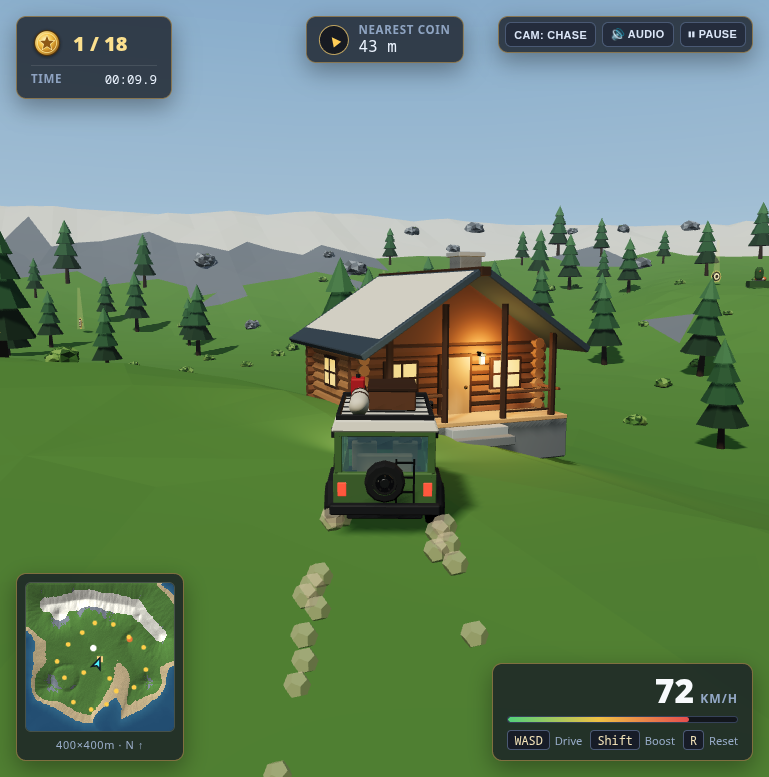 | 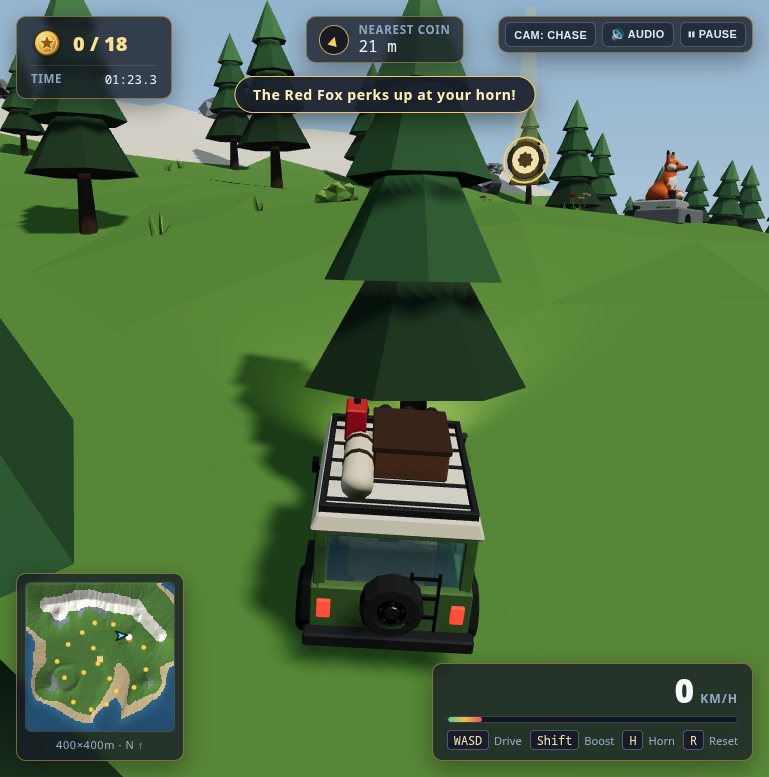 |

Run locally (zero bundler required):
```sh
python3 -m http.server 8765 --directory docs/demo
# Open http://localhost:8765/
```

---

## Showcase (100% Compiled from Plaintext DSL)

### 3D Game Assets (`.mdl` → `.glb` / `.gltf`)
All showcase packs below share a single **2.9 KB** 3-map PBR palette atlas ([`examples/palette.pal`](examples/palette.pal)) and pass strict glTF 2.0 binary & outward-normal validation:

| Off-Road 4×4 Vehicle (2 draws, translucent interior) | Red Fox on Carved Stones (1 draw, SDF metaballs + BSP CSG) |
| :---: | :---: |
|  | 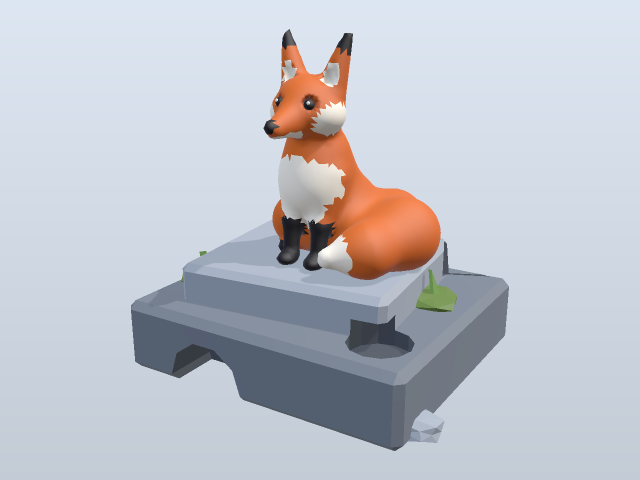 |
| [`offroad_4x4.mdl`](examples/models/offroad_4x4.mdl) | [`fox_on_stones.mdl`](examples/models/fox_on_stones.mdl) |

| Machinist's Workbench & Tools (`wn=1` bevels, CSG, 2 child nodes) | Face-Weighted Normals (`sm=0` vs `sm=1` vs `wn=1`) |
| :---: | :---: |
| 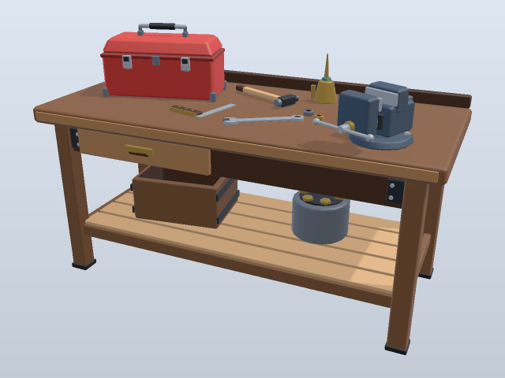 | 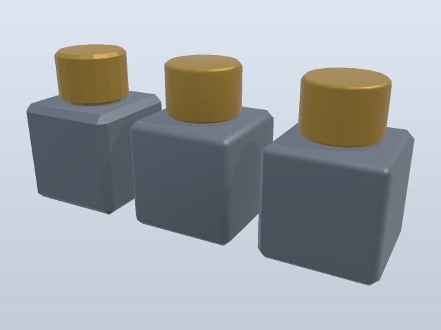 |
| [`workbench_tools.mdl`](examples/models/workbench_tools.mdl) | Single-segment `bev=` + `wn=1` (zero normal maps) |

| Modular Dungeon Kit (6 snap tiles, 1 draw call) | Weapon & Pickup Props (1 draw call) |
| :---: | :---: |
| 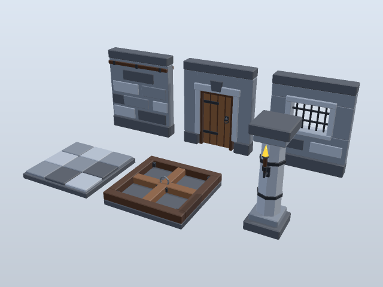 |  |
| [`modular_dungeon_kit.mdl`](examples/models/modular_dungeon_kit.mdl) | [`props_shotgun_medkit.mdl`](examples/models/props_shotgun_medkit.mdl) |

### Skeletal Rigging, IK, Keyframe Animation & Blend Shapes (`.mdl` → animated `.glb`)
Author full humanoid or mechanical rigs (`skel` + `m=x` auto-mirrored bones using Godot/Mixamo/UE5/Rigify naming), automatic capsule-distance + connectivity-smoothed skinning mixed with rigid `bone=` armor plates, compile-time **2-bone analytical & FABRIK N-bone IK**, **glTF 2.0 morph targets / blend shapes** (`morph` + `mesh.extras.targetNames`), and **animation frame events** (`ev` → `animation.extras.events`) — with built-in `--bones` X-ray overlays, 4-view `--paths` motion arcs, `--morph` previews, and compact `--anim-sheet` filmstrips:

| Clockwork Automaton (16 Bones, `wn=1` Armor, 3 Morphs) | 4-View X-Ray Skeleton Overlay (`--bones`) |
| :---: | :---: |
| 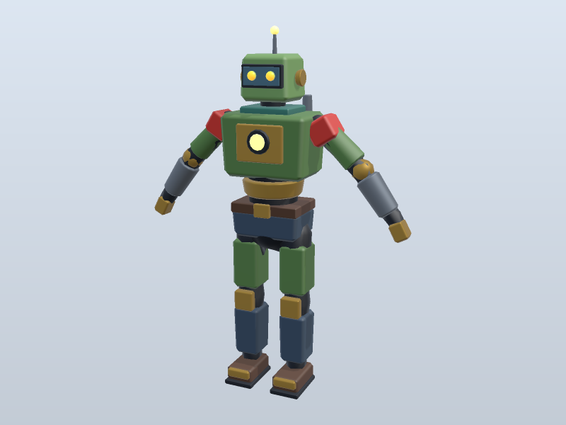 | 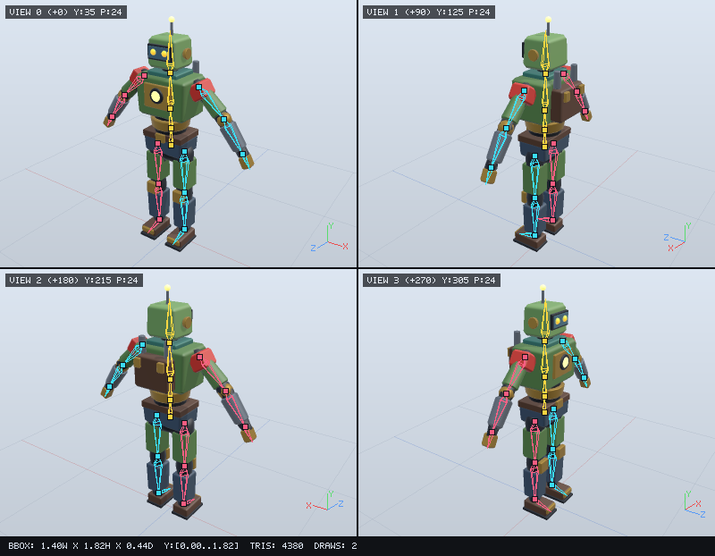 |
| [`clockwork_automaton.mdl`](examples/models/clockwork_automaton.mdl) | Gold = Spine, Cyan = Left, Coral = Right |

| 2-Bone IK Walk Cycle + Footstep Events (`--anim-sheet`) | IK Wave + `happy`/`blink`/`breathe` Blend Shapes |
| :---: | :---: |
| 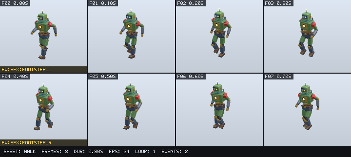 | 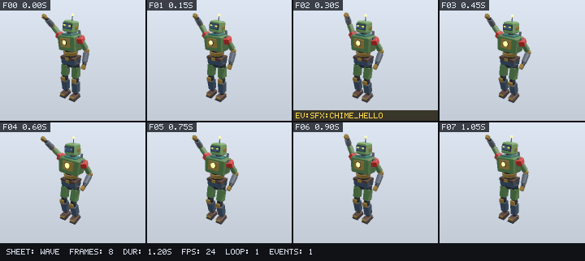 |
| `anim walk` (2-bone IK legs & arms + `ev sfx:footstep_*`) | `anim wave` (IK arm wave + `mw` blend shapes + `ev`) |

### Procedural Audio, Seamless Loops & Music (`.sfx` / `.kit` → `.wav`)
Pure-DSP synthesis (PolyBLEP oscillators, stereo supersaws, FM, modal partials, Karplus-Strong plucks, 4 noise colors, Cytomic TPT SVF filters, Freeverb, tempo-synced ping-pong delay, 2-cycle pre-warm seamless looping, `--var N` variations) with visual spectrogram & loop-seam verification:

| Living Stereo Woodland Ambience (8s seamless loop, `seam=0.010`) | 4-Bar Multi-Track Musical Loop (116 BPM, `seam=0.005`) |
| :---: | :---: |
|  | 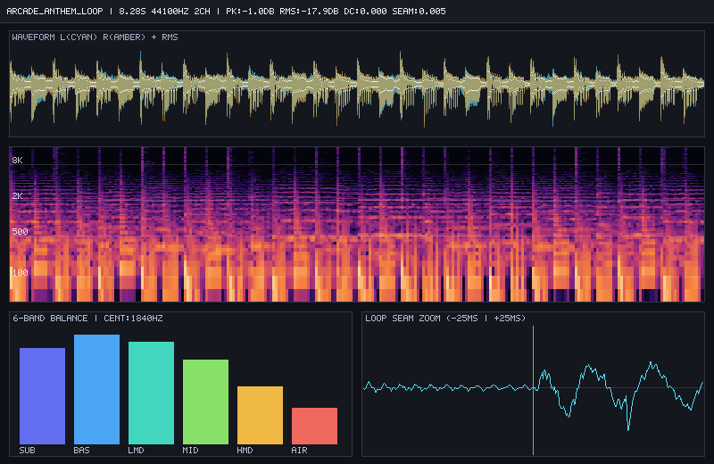 |
| [`woodland_ambience.sfx`](examples/audio/woodland_ambience.sfx) | [`arcade_anthem_loop.sfx`](examples/audio/arcade_anthem_loop.sfx) |

<details>
<summary><b>▶ Listen: Living Stereo Woodland Ambience</b> (2 seamless 8s loops)</summary>

https://github.com/user-attachments/assets/bf12b342-ffc5-4ce0-be2c-579f207f7ba0

</details>

<details>
<summary><b>▶ Listen: Arcade Anthem 4-Bar Musical Loop</b> (116 BPM, 2 seamless loops)</summary>

https://github.com/user-attachments/assets/7e0c8df5-8e6c-4028-8692-994167e55e3a

</details>

Also included: [`footstep_gravel.sfx`](examples/audio/footstep_gravel.sfx) (`--var 4` foley variations) and [`boss_impact_sfx.sfx`](examples/audio/boss_impact_sfx.sfx) (layered modal/sub impact) using shared voice library [`kit.kit`](examples/audio/kit.kit).

### 2D Game UI & Vector Icons (`.svg` → `.png` + Visual QA)
Zero-dependency SVG validator & 4-subscanline anti-aliased rasterizer (shapes, full `<path>` including arcs/Beziers, transforms, linear/radial gradients, `<clipPath>`, `<use>`, `<feGaussianBlur>`/`<feDropShadow>`, GPU transparent alpha-bleed, and `--preview` checkerboard/grid/`--9slice` QA HUD — keeping UI fonts in-engine for clean localization):

| Dark-Fantasy HUD & Dullahan Portrait (Transparent PNG) | Built-in Visual QA Preview (`--preview --grid`) |
| :---: | :---: |
| 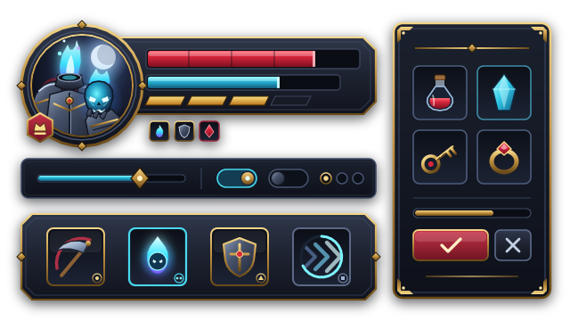 | 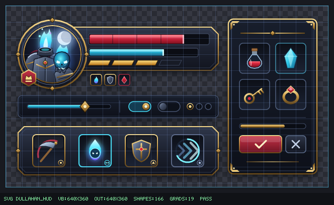 |
| [`dullahan_hud.svg`](examples/ui/dullahan_hud.svg) | [`dullahan_hud.svg`](examples/ui/dullahan_hud.svg) |

### Eroded Landscapes & Terrain (`.ter` → 16-bit Heightmap + Weightmap + Low-Poly `.glb`)
Macro layout stamps (`island`, `ridge`, `peak`, `plateau`, `valley`, `crater`, or external sketch PNG `base`), multi-octave/warped noise, 65k-droplet particle hydraulic & thermal erosion, 4-channel biome weightmaps, 16-bit lossless PNG heightmaps, and QEM curvature-preserving low-poly `.glb` export (also supports `--from-heightmap` + `--weightmap` directly):

| Low-Poly QEM-Decimated Diorama (`.glb`, 2 draws w/ water) | 2×2 Terrain Diagnostics (Hillshade, Heatmap, Flow, Splats) |
| :---: | :---: |
| 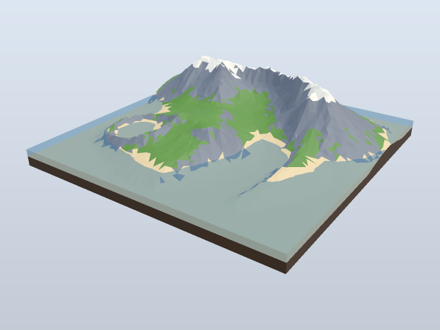 | 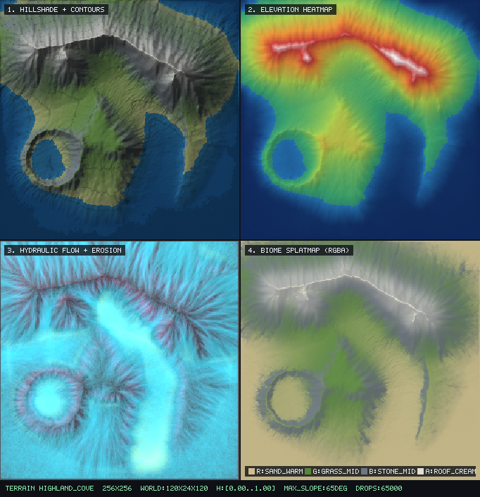 |
| [`highland_cove.ter`](examples/terrain/highland_cove.ter) | [`highland_cove.ter`](examples/terrain/highland_cove.ter) |

### Seamless 1K PBR Textures & Architectural Trim Sheets (`.tex` + `.svg` → Albedo + Normal + Height16 + ORM)
Sculpt seamlessly tileable 3D reliefs (`mesh` + beveled `wn=1` `stones`, auto-wrapped toroidally across `wrap=xy` or `wrap=x` for trim sheets), orthographically bake **2×2 SSAA Albedo, Tangent-Space Normal (OpenGL `+Y` or DirectX `-Y`), 16-bit Displacement, and Horizon-Based AO + ORM**, and layer geometry-masked procedural weathering (`grain`, `edge` chipping, `cavity` grime, `moss`) plus **seamlessly wrapped `.svg` vector cracks, moss tufts, and carved bas-relief friezes** that sculpt directly into the normal map, heightmap, and AO:

| 1K Mossy Stone Wall (`wrap=xy`, `seam=0.000`, 3D PBR Sphere) | 1K Matching Stone Trim Sheet (`wrap=x`, Carved SVG Frieze, 3D Pillar) |
| :---: | :---: |
| 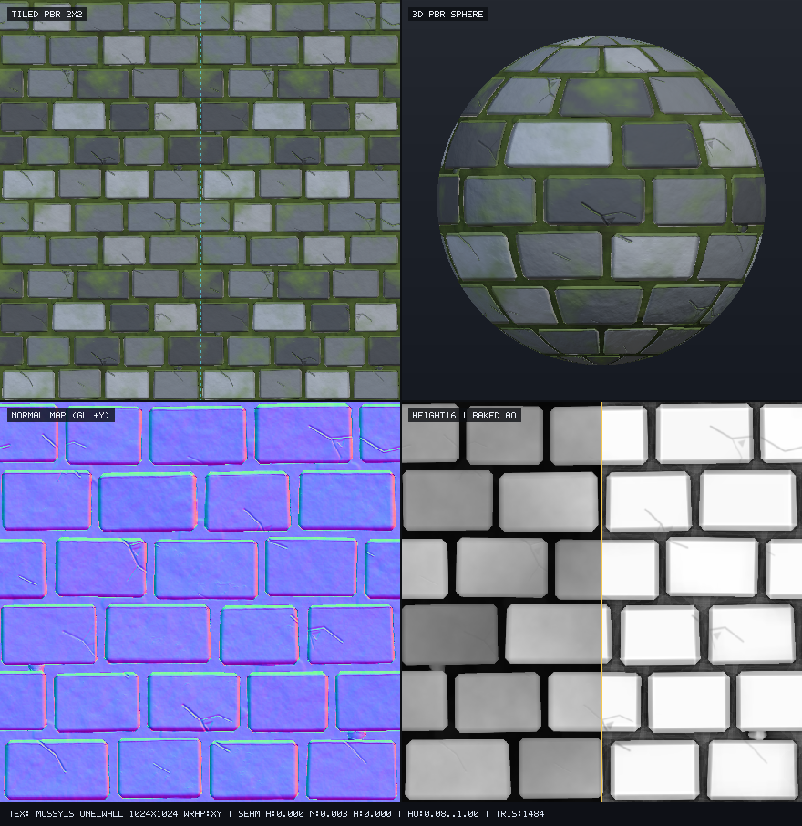 | 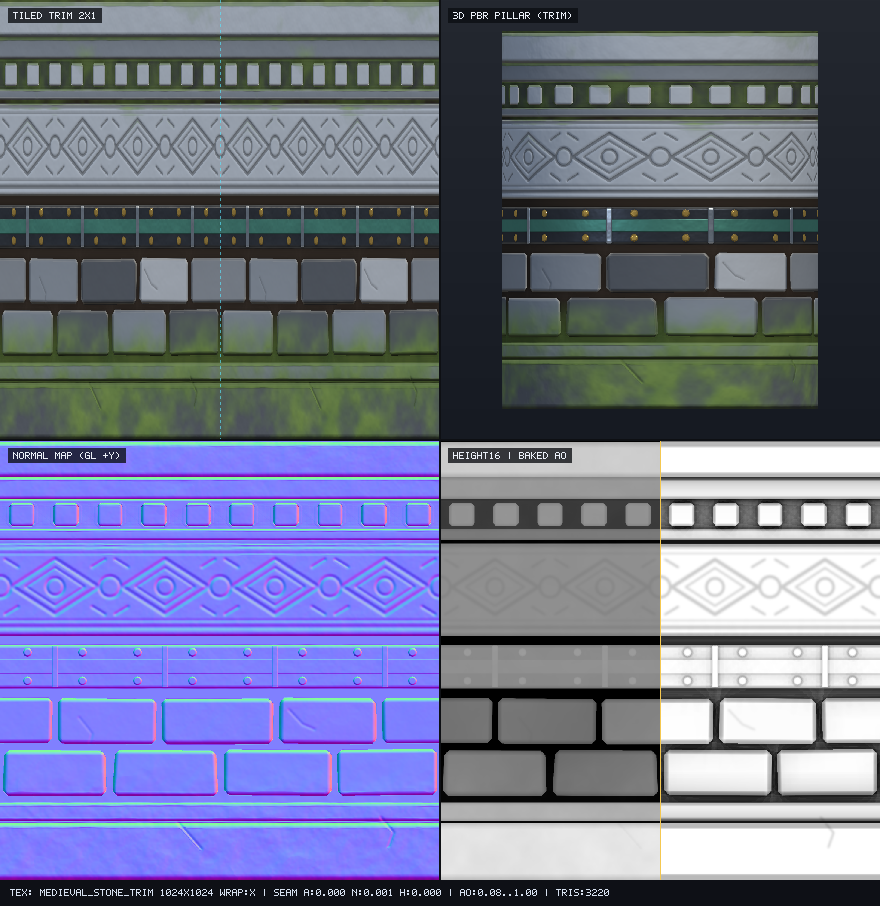 |
| [`mossy_stone_wall.tex`](examples/textures/mossy_stone_wall.tex) + [cracks](examples/textures/wall_cracks_chips.svg) / [moss](examples/textures/wall_moss_tufts.svg) | [`medieval_stone_trim.tex`](examples/textures/medieval_stone_trim.tex) + [carved frieze](examples/textures/trim_carvings.svg) |

---

## Why Dullahan Artisan?

- **Headless & Instant**: Single **~1.7 MB** static binary compiled from zero-dependency Rust (`std` only) — builds and runs natively on **Linux, macOS, and Windows** with millisecond startup.
- **Built for LLMs (No MCP Required)**: Compact line-oriented syntax with short opcodes, `$var` math expressions, semantic material/voice names, `@id` part tags (`--focus <id>` zoom inspection), shared 3D/audio kits (`use ../kit.mdl` / `use ../kit.kit`), CLI colorway overrides (`--ov old:new`), and `def`/`use`/`m=`/`rep=`/`rad=` composition — easy to read, diff, and patch directly via standard shell & file tools.
- **Game-Engine Friendly**: Every opaque 3D model batches matte, metallic, and emissive surfaces into **1 single PBR draw call** using standard glTF 2.0 / Godot 4 / UE5 / Unity `BaseColor` + `ORM` + `Emissive` atlases (embed by default or share externally via `--ext-pal`), supports **Face-Weighted Normals (`wn=1`)** for razor-sharp 1-segment bevel specular highlights with zero normal maps, **native glTF 2.0 skeletal skinning (`skel`), 2-bone & FABRIK IK, keyframe animations with `extras.events`, and named blend shapes / morph targets (`morph`)**, nested **animated child nodes** (`node <name> x,y,z ... end` with local pivots), separate **collider nodes** (`col <name> ... end` for Godot `-colonly`/`-convcolonly` and Unreal `UBX_`/`UCX_`), double-sided foliage (`tri ds=1`, curved `rib`), and transparent edge alpha-bleed on SVG UI exports.
- **Closed-Loop QA Built In**:
  - **3D & Animation**: Multi-threaded 2×2 SSAA PBR software renderer with backface culling, PCF shadows, 2×2 turnarounds with grid/axis HUD, `--focus <id>` close-ups, `--bones` 4-view X-ray rig overlays, `--paths` 4-view motion-arc plots, `--anim-sheet` thumbnail strips with event badges, `--morph` expression previews, and strict GLB/glTF validator (checking outward normals, skin weights, morph targets, and animation channels).
  - **Audio**: Quantitative CLI telemetry (`peak`, `RMS`, `DC`, `clip`, `seam Δ`, 6-band balance) + 5-panel Magma spectrogram & ±25 ms loop-seam zoom PNG.
  - **2D UI / SVG**: Strict XML/path/ref/viewBox-overflow validator + 4-subscanline AA PNG rasterizer with checkerboard/grid/`--9slice` QA previews.

### A Taste of the DSL

```text
# Shared PBR atlas (.pal) — one line per tile -> BaseColor + ORM + Emissive maps
grid 8x8@16 bg=#d4dde8
wood_oak    #744d30   .84  0     -
steel_mid   #8b949e   .32  .95   -
glass_tint  #76bcd870 .08  .06   -
beacon_gold #fff4b8   .20  0     #ffcc44
```

```text
# 3D model (.mdl) — variables, chamfered bevels, smooth normals, bend/twist, templates & mirrors
pal ../palette.pal
$h=2.4
cyl @pillar  stone_light 0,.38,0  .26,.24,$h-.76 seg=8 a=b bev=.015
box @arch    stone_light 0,$h,0   2.2,.26,.38    bev=.025 bend=-110:x:y
```

```text
# Procedural audio (.sfx) — left-to-right pipe DSP chains, step grids, chord sequences & loops
sfx footstep_gravel dur=.34 ch=2 norm=-1
osc sin 104 dur=.065 penv=104>38:.048 env=.002,.042,0,.016 g=.44
noi pink    dur=.13  cenv=2500>820:.095 env=.004,.085,0,.032 g=.72 | flt bp 1650 q=1.1
bus | flt hp 38
```

---

## Build & Install

Requires only a standard Rust toolchain (`cargo`):

```sh
# Install `artisan` directly onto your PATH (Linux / macOS / Windows)
cargo install --path .

# Or build a standalone stripped release binary in target/release/
cargo build --release
```

## Quick Commands

```sh
# Build 3 PBR atlases (_basecolor, _orm, _emissive) + labeled swatch preview sheet
artisan pal examples/palette.pal -o out/palette --sheet out/palette_sheet.png

# Compile .mdl -> validated .glb (or .gltf) + PBR hero, turnaround & focused zoom renders
artisan mesh examples/models/offroad_4x4.mdl -o out/offroad_4x4.glb --render out/offroad_4x4.png --turn out/offroad_4x4_turn.png --yaw 35 --pitch 20
artisan mesh examples/models/fox_on_stones.mdl -o out/fox_on_stones.glb --render out/fox_on_stones.png --turn out/fox_on_stones_turn.png --yaw 32 --pitch 18
artisan mesh examples/models/workbench_tools.mdl -o out/workbench_tools.glb --ov red_paint:slate_blue --render out/workbench_blue.png --yaw 24 --pitch 24
artisan mesh examples/models/modular_dungeon_kit.mdl -o out/modular_dungeon_kit.glb --render out/dungeon.png --turn out/dungeon_turn.png --yaw 28 --pitch 26
artisan mesh examples/models/props_shotgun_medkit.mdl --focus medkit --render out/medkit_zoom.png

# Compile rigged & animated .mdl (skeleton + IK + blend shapes) -> .glb + X-ray rig, motion paths & filmstrip QA
artisan mesh examples/models/clockwork_automaton.mdl -o out/clockwork_automaton.glb --turn out/rig.png --bones
artisan mesh examples/models/clockwork_automaton.mdl --anim walk --paths out/walk_paths.png --anim-sheet out/walk_sheet.png --frames 8
artisan mesh examples/models/clockwork_automaton.mdl --focus head_unit --morph blink:1 --render out/blink.png

# Synthesize one-shot variations or seamless loops + 5-panel diagnostic PNG
artisan sfx examples/audio/footstep_gravel.sfx -o out/footstep_gravel.wav --var 4 --plot out/footstep_diag.png
artisan sfx examples/audio/woodland_ambience.sfx -o out/woodland_ambience.wav --plot out/woodland_diag.png
artisan sfx examples/audio/arcade_anthem_loop.sfx -o out/arcade_anthem_loop.wav --plot out/anthem_diag.png

# Validate & rasterize Game-UI SVG -> transparent RGBA PNG + QA checkerboard/grid preview
artisan svg examples/ui/dullahan_hud.svg -o out/dullahan_hud.png --preview out/dullahan_hud_preview.png --grid

# Generate eroded 16-bit heightmap, RGBA biome weightmap, 2x2 diagnostics & QEM-decimated low-poly .glb
artisan terrain examples/terrain/highland_cove.ter -o out/highland_cove --preview out/highland_diag.png --mesh out/highland_cove.glb --render out/highland_3d.png --grid 72 --tris 3400

# Or convert an external heightmap + weightmap PNG directly into a low-poly .glb mesh
artisan terrain --from-heightmap out/highland_cove_height16.png --weightmap out/highland_cove_splat.png -p examples/palette.pal --world 120,24,120 --tris 2400 --mesh out/from_hm.glb

# Bake 1K seamless PBR tileable textures & horizontal architectural trim sheets (Albedo + Normal + Height16 + ORM + 2x2 QA)
artisan tex examples/textures/mossy_stone_wall.tex -o out/mossy_stone_wall --preview out/wall_qa.png --grid
artisan tex examples/textures/medieval_stone_trim.tex -o out/medieval_stone_trim --preview out/trim_qa.png --grid --dx

# Print the canonical DSL & SVG grammar straight from the binary
artisan spec
```

## Agent Skill

Ready-to-install, cross-platform, genre-neutral Agent Skill: [`skill/dullahan-artisan/`](skill/dullahan-artisan/SKILL.md) (including concise universal modeling & sound-design craft principles under [`references/`](skill/dullahan-artisan/references/)).

Install `artisan` on your `PATH` and copy or symlink `skill/dullahan-artisan` into your coding agent's skills directory.
